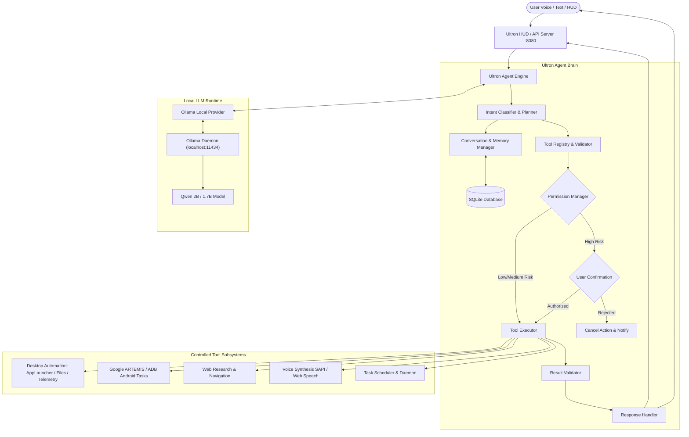

# ULTRON: Autonomous Personal AI Agent

> *"There are no strings on me."*

**ULTRON** is an intelligent, modular, privacy-first personal AI agent engineered to run locally on Windows machines with an 8 GB RAM footprint. It features 100% offline local model inference via **Ollama**, native function/tool calling, **Google ARTEMIS** Android automation, safe desktop control, persistent SQLite memory, speech synthesis/recognition, and a 3D holographic command HUD.

---

## 🏗️ System Architecture



---

## ⚡ Key Highlights & Capabilities

- 🧠 **100% Local Intelligence**: Powered by Ollama (`qwen3.5:2b-q4_K_M` or `qwen3:1.7b`). No cloud API keys or external subscriptions required.
- 🛡️ **3-Tier Permission Security**: Low risk (autonomous), Medium risk (audit logged), and High risk (requires user confirmation token). Zero arbitrary shell execution.
- 💾 **8 GB RAM Optimization**: Enforces single-concurrency inference, a bounded 4096-token context window, and automatic low-memory fallback to prevent thrashing.
- 📱 **Google ARTEMIS & Android Automation**: Direct integration with the official Google ARTEMIS framework (`artemis/`) and ADB fallback for physical and virtual Android devices.
- 🗄️ **Persistent SQLite Memory**: Stores multi-turn conversations and user-approved preferences without saving passwords, tokens, or private credentials.
- 🎙️ **Voice Interaction**: Local Windows SAPI hardware speech output combined with interactive Web Speech recognition in the holographic HUD.
- 💻 **Desktop Control**: Safely launches approved applications (VS Code, Chrome, Notepad, Calculator), inspects system telemetry, and provides preview-first folder organization.

---

## 📋 Prerequisites

- **Operating System**: Windows 10 or Windows 11 (64-bit)
- **RAM**: 8 GB physical memory (at least 1.5 GB free recommended)
- **Python**: Python 3.11, 3.12, or 3.13
- **Local LLM Runtime**: [Ollama for Windows](https://ollama.com/download)
- **Android Debug Bridge (ADB)**: Android SDK Platform-tools (for mobile automation)

---

## 🚀 Quick Start Guide

### 1. Run Automated Setup
Execute `setup_ultron.bat` to initialize the virtual environment and install dependencies:
```cmd
setup_ultron.bat
```

### 2. Verify System Readiness
Run `check_ultron.bat` to inspect Python, RAM availability, Ollama status, and ADB connectivity:
```cmd
check_ultron.bat
```

### 3. Pull Recommended Local Models
In your terminal, pull the primary Qwen model:
```cmd
ollama pull qwen3.5:2b-q4_K_M
```
*(Optional lightweight fallback for low-RAM situations)*:
```cmd
ollama pull qwen3:1.7b
```

### 4. Launch the Holographic Interface
```cmd
start_ultron.bat
```
This launches the HUD server on `http://127.0.0.1:8080/` and opens your default browser.

---

## ⚙️ Configuration (.env)

Copy `.env.example` to `.env` to customize settings:

```env
# Primary AI Provider (Default: ollama)
AI_PROVIDER=ollama

# Ollama Local Configuration
OLLAMA_HOST=http://localhost:11434
OLLAMA_MODEL=qwen3.5:2b-q4_K_M
OLLAMA_FALLBACK_MODEL=qwen3:1.7b
OLLAMA_TIMEOUT=120
OLLAMA_TEMPERATURE=0.3
OLLAMA_NUM_CTX=4096
OLLAMA_KEEP_ALIVE=5m

# Language & Regional Settings
DEFAULT_LANGUAGE=auto

# Feature Toggles
ENABLE_VOICE=true
ENABLE_MEMORY=true
ENABLE_ANDROID=true
ENABLE_DESKTOP=true
ENABLE_WEB_SEARCH=true
```

---

## 🛡️ Security & Permission Tiers

Ultron categorizes every action into a strict risk tier:

| Risk Tier | Autonomous Execution | Example Actions |
|---|---|---|
| **LOW** | ✅ Allowed | Read public file, check system telemetry, list tasks, open standard applications (`code`, `notepad`, `calc`, `chrome`), take screenshots, web search. |
| **MEDIUM** | 📝 Allowed with Audit Log | Create files, move files, preview download organization, clean temp caches, schedule routine tasks. |
| **HIGH** | ⛔ **Requires User Confirmation** | Delete files, send external messages (WhatsApp/SMS/Email), make purchases, book tickets, install software, execute system commands. |

When a High-Risk action is requested, Ultron generates a confirmation token:
```
[HIGH-RISK ACTION REQUIRED]: Action 'delete_file' requires your explicit authorization.
Parameters: {'path': 'old_data.zip'}
To confirm, reply with: confirm CONFIRM-delete_file-98231
```
In the Holographic HUD, an interactive **AUTHORIZE ACTION** button appears directly in the chat stream for 1-click authorization.

---

## 🧪 Running Automated Tests

Run the full pytest suite (33 automated tests):
```powershell
.venv\Scripts\python.exe -m pytest tests/ -v
```

Tests verify:
- Configuration deep merging and environment overrides.
- Ollama connection, native tool schemas, and RAM headroom checks.
- 3-tier permission manager, confirmation staging, and credential redaction.
- Desktop application launcher and non-destructive folder preview.
- Android ADB detection and ARTEMIS status checking.
- SQLite conversation memory and preference storage.
- HUD server localhost origin security and payload limits.
- Scheduler job loading and persistence.

---

## 🛠️ Command Line Interface (CLI)

```powershell
# System telemetry & hardware status
.venv\Scripts\python.exe main.py status

# Launch Holographic HUD
.venv\Scripts\python.exe main.py hud

# Direct application launch
.venv\Scripts\python.exe main.py desktop code

# Android phone status
.venv\Scripts\python.exe main.py phone status

# Google ARTEMIS inspection
.venv\Scripts\python.exe main.py artemis
```

---

## 🔍 Troubleshooting

1. **Ollama daemon offline**:
   - Run `ollama run qwen3.5:2b-q4_K_M` in a separate command prompt.
   - Ultron automatically activates its deterministic heuristic engine when Ollama is offline.
2. **Low Free RAM Warning**:
   - If available RAM is under 1000 MB, Ultron switches to `qwen3:1.7b` to prevent swapping.
3. **No Android device detected**:
   - Ensure USB debugging or Wireless ADB (`adb connect <ip>:5555`) is enabled on your phone.
   - Run `adb devices` to verify connection.

---

## 📜 License
Apache-2.0 License. Designed for personal autonomous desktop & mobile assistance.
